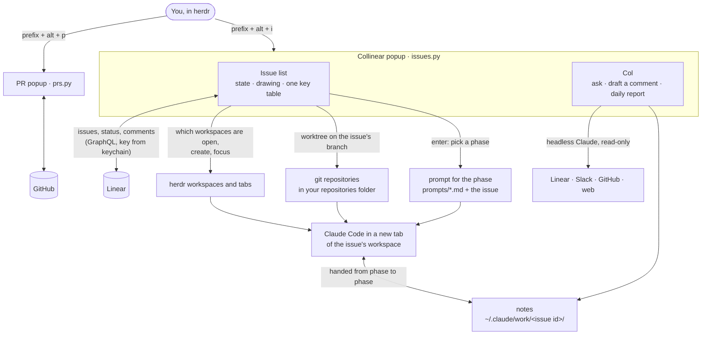

<p align="center">
  
</p>

Collinear is a popup for [herdr](https://herdr.dev) that shows your Linear issues and turns one into a running
coding session in a single key press, so you never lose track of what you are working on, where its code is checked
out, or which workspace it lives in.

## Install

Needs macOS, herdr 0.9.5+, Python 3, `git`, the [GitHub CLI](https://cli.github.com) and
[Claude Code](https://claude.com/claude-code).

```sh
git clone https://github.com/eriksalsborn/collinear ~/collinear
python3 ~/collinear/install.py
```

Then press `prefix + alt + i` in herdr. The first time, Col shows a checklist and fixes most of it with you right
there (Linear key, repositories folder, and so on).

If that key is already yours: `python3 ~/collinear/install.py --issues-key prefix+alt+l`.
To update: `git -C ~/collinear pull && python3 ~/collinear/install.py`.

## Good to know

- `?` lists every key. Everything is also clickable.
- Starting an issue makes a git worktree at `<repo>-wt/<branch>`; your main checkout is never touched.
- A herdr workspace belongs to an issue when its name starts with the issue id (`ENG-123 …`).
- Col only reads (Linear, Slack, GitHub, the web). Nothing is posted until you confirm.
- `D` reopens setup, `U` undoes the last change, `B` gives Col a bone.

## How it works



## Tests

```sh
python3 issues.py --test && python3 test_ui.py
```

## License

[MIT](LICENSE)
