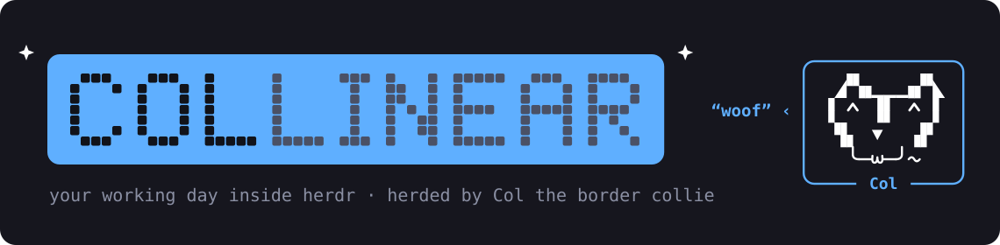
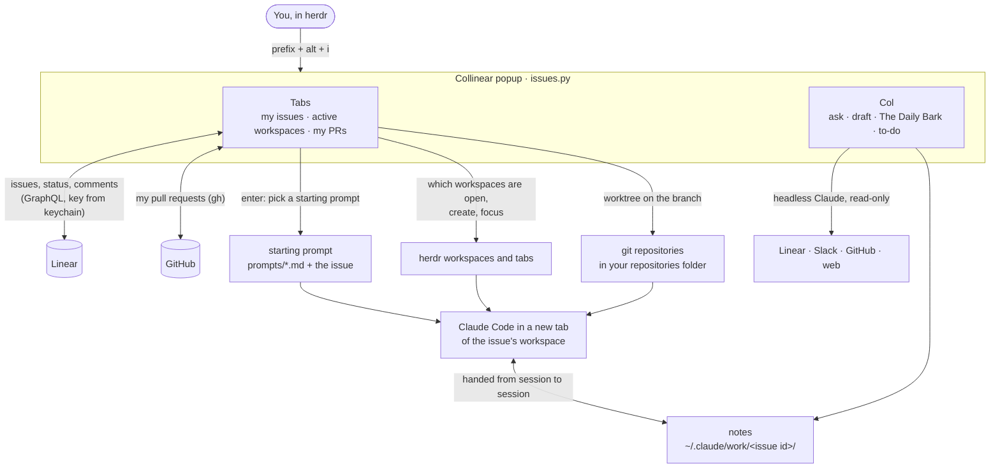

<p align="center">
  
</p>

Collinear is a popup for [herdr](https://herdr.dev) that runs your working day from one key press, herded by Col
the border collie.

- **Col reads everything so you don't.** Each morning he goes through Slack, your Linear comments and your pull
  request reviews, and writes The Daily Bark: what you got done, and the loose threads nobody followed up on.
- **Every thread is one key from handled.** Start a coding session on it, turn it into a Linear issue, park it on
  your to-do list, or discard it. Col won't bring a parked or discarded one up again.
- **One key from issue to working session.** `enter` gives an issue its herdr workspace, a git worktree on its
  branch, and Claude Code already briefed on it.
- **Nothing gets lost.** Your issues, pull requests and to-dos show where their work is running, and `w` jumps there.

What Col hands you in the morning (an example):

```text
 TUESDAY
  • PLA-41 rate limiting — merged, PR #212. PLA-38 is in review since Monday.

 LOOSE THREADS
  • PLA-38 retry budget — reply to Sam: should retries count against the limit?
    ↳ Sam's review comment on PR #209, Monday
  • Flaky checkout test — file an issue, it failed three runs this week.
    ↳ Robin in #dev, Tuesday · no Linear issue yet

 enter actions   a ask Col about it   s move to to-do   x discard it
```

## Install

Needs macOS, herdr 0.9.5+, Python 3, `git`, the [GitHub CLI](https://cli.github.com) and
[Claude Code](https://claude.com/claude-code).

```sh
git clone --branch stable https://github.com/eriksalsborn/collinear ~/collinear
python3 ~/collinear/install.py
```

Press `prefix + alt + i` in herdr. Col checks your setup, fixes most of it with you (Linear key, repositories
folder), then walks you through the app: he names a key, you press it. `Q` quits the tour, `O` starts it again.

- Key already taken: `python3 ~/collinear/install.py --issues-key prefix+alt+l`
- Update: `git -C ~/collinear pull && python3 ~/collinear/install.py`
- `stable` is the latest [release](https://github.com/eriksalsborn/collinear/releases); `main` is work in progress.

## What `enter` sets up

On an issue, a pull request, or a topic from the report or the to-do list:

- a herdr workspace named after it, or a new tab in the one already open,
- a git worktree on its branch, in the repo you pick, with your main checkout left alone,
- Claude Code opened there, briefed on the issue, its comments and your notes from earlier sessions,
- a starting prompt: write it, plan it, build it (ending in a draft PR) or review it. Or none, and you steer.

## Keys

Everything is also clickable, and `?` shows this list in the app.

| | |
|---|---|
| **Work on an issue** | `enter` start · `space` preview · `w` jump to its workspace · `a` ask Col · `C` comment · `c` free session |
| **Change it** | `S` status · `P` priority · `A` assign · `X` cancel · `U` undo · `n` new issue |
| **Open elsewhere** | `g` pull request · `L` Linear · `y` copy link |
| **Views** | `;` next tab · `h` previous tab (my issues, active workspaces, daily bark, to-do, my PRs) · `b` daily bark · `p` to-do list · `M` my PRs · `W` active workspaces · `t` team · `T` project · `R` review inbox · `r` refresh |
| **Move** | `j` / `k` · `5j` · `G` last · `/` or just type to filter |
| **The rest** | `O` the tour · `D` setup · `K` hints on/off · `Z` Col on/off · `B` give Col a bone · `h` back · `esc` close (`q` too; `h` never closes) |

## Development

```sh
python3 issues.py --test && python3 test_ui.py
```



## License

[MIT](LICENSE)
