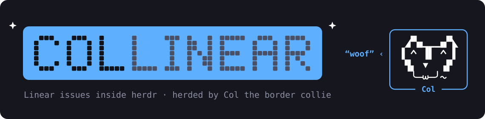

<p align="center">
  
</p>

Collinear is a popup for [herdr](https://herdr.dev) that shows your Linear issues and turns one into a running
coding session in a single key press, so you never lose track of what you are working on, where its code is checked
out, or which workspace it lives in.

## Install

Needs macOS, herdr 0.9.5+, Python 3, `git`, the [GitHub CLI](https://cli.github.com) and
[Claude Code](https://claude.com/claude-code).

```sh
git clone --branch stable https://github.com/eriksalsborn/collinear ~/collinear
python3 ~/collinear/install.py
```

Then press `prefix + alt + i` in herdr. The first time, Col shows a checklist and fixes most of it with you right
there (Linear key, repositories folder, and so on). Then he takes you on [the tour](#the-tour).

If that key is already yours: `python3 ~/collinear/install.py --issues-key prefix+alt+l`.
To update: `git -C ~/collinear pull && python3 ~/collinear/install.py`.

`stable` is the latest [release](https://github.com/eriksalsborn/collinear/releases) and only moves when a new one is
published; `main` is work in progress. Cloned `main` earlier? `git -C ~/collinear switch stable`.

## The tour

Right after setup, Col walks you through the app for real: he says each step from his speech bubble and you press
the key, so the preview, the comments, The Daily Bark and the start dialog actually open in front of you.

- It covers moving around, reading and writing comments, asking Col, changing status / priority / assignee,
  the daily report, the green markers and `w`, and what starting work does.
- Only the key he asks for works while it runs, so you can't get lost or post anything by accident.
- `Q` quits it at any time. `O` starts it again whenever you want.

## Good to know

- **One key from issue to working session.** `enter` makes a git worktree on the issue's branch and opens Claude
  Code on it in the issue's own herdr workspace.
- **It knows where your work is.** Issues with a workspace open are marked, with repository and branch, and `w`
  jumps straight there.
- **Col writes your daily report.** A recap of your last working day from Linear, Slack, GitHub and your own commits, so you can pick
  the threads back up.

## How it works


## Tests

```sh
python3 issues.py --test && python3 test_ui.py
```

## Keys

Everything is also clickable, and `?` shows this list in the app.

| | |
|---|---|
| **Work on an issue** | `enter` start · `space` preview · `w` jump to its workspace · `a` ask Col · `C` comment · `c` free session |
| **Change it** | `S` status · `P` priority · `A` assign · `X` cancel · `U` undo · `n` new issue |
| **Open elsewhere** | `g` pull request · `L` Linear · `y` copy link |
| **Views** | `b` daily report · `t` team · `T` project · `R` review inbox · `r` refresh |
| **Move** | `j` / `k` · `5j` · `G` last · `/` or just type to filter |
| **The rest** | `O` the tour · `D` setup · `K` hints on/off · `Z` Col on/off · `B` give Col a bone · `h` back · `q` close |

## License

[MIT](LICENSE)
